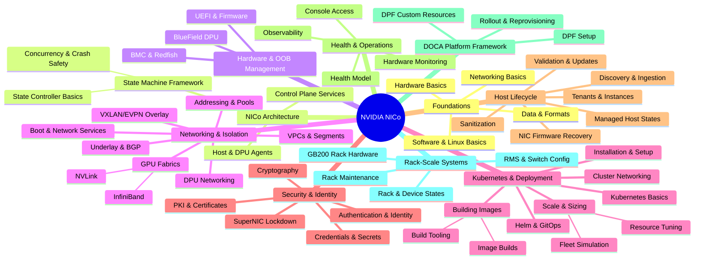

# NVIDIA NICo (NVIDIA Infra Controller): mind map

The whole topic grouped by theme (D-022). GitHub draws these diagrams; elsewhere, paste a block into <https://mermaid.live>.

## Themes

## Everything

Each concept shows the chapter that teaches it; ✓ means you already know it.

```mermaid
mindmap
  root((NVIDIA NICo))
    Foundations
      Hardware Basics
        MAC address · ch 1
        PCIe device · ch 1
        NUMA node · ch 1
        PCI device and slot address · ch 1
        CPU architectures amd64 vs arm64 · ch 1
        Network interface card NIC · ch 2
        Server hardware basics · ch 1
      Networking Basics
        CIDR prefixes and /31 point-to-point subnets · ch 3
        Firewall rules · ch 3
        HTTP and web APIs · ch 3
        IP addressing basics · ch 3
        IP networking fundamentals · ch 3
        Layer 2 Ethernet networking · ch 3
        SSH · ch 22
      Software & Linux Basics
        Asynchronous programming async/await · ch 2
        Containers and container images · ch 2
        Git version control · ch 2
        Linux memory and cgroups · ch 2
        Linux system administration basics · ch 2
        Microservices architecture · ch 4
      Data & Formats
        TOML · ch 1
        Protocol Buffers · ch 1
        Relational databases and SQL · ch 1
        YAML · ch 1
    NICo Architecture
      Control Plane Services
        Admin CLI · ch 31
        API Service NICo Core · ch 31
        NICo REST JSON API · ch 31
        Site Agent · ch 31
        Site Controller · ch 18
        Temporal workflow engine · ch 4
        nicocli · ch 31
      Host & DPU Agents
        DPU Agent · ch 38
        Metadata Service FMDS · ch 41
        Scout · ch 41
        IPv6 metadata transport · ch 41
        Rate limiting GCRA token bucket · ch 4
      State Machine Framework
        State Controller Basics
          State machine resource lifecycle · ch 30
          Desired vs actual state reconciliation · ch 30
          Service-level agreement SLA for states · ch 30
          State controller work queue and claims · ch 30
          State handler outcomes · ch 31
          Controller State Persistence · ch 30
          State Controller Tick · ch 31
        Concurrency & Crash Safety
          Asynchronous job polling · ch 31
          Database transaction · ch 4
          Idempotency · ch 4
          Iteration invalidation · ch 31
          Optimistic concurrency / stale-write protection · ch 4
          Recovery point and crash-window reconciliation · ch 30
          WorkLock lease and fencing · ch 4
      Bare-metal lifecycle management · ch 5
      NICo NVIDIA Infra Controller · ch 23
      NICo scope boundaries · ch 23
      Zero-trust host model · ch 23
      Day 0 / Day 1 / Day 2 lifecycle · ch 5
    Hardware & OOB Management
      BMC & Redfish
        Baseboard Management Controller BMC · ch 6
        Redfish API · ch 6
        Power control reset types · ch 6
        libredfish and nv-redfish · ch 6
        Redfish resource tree Systems, Chassis, Managers · ch 6
        Redfish Task Service · ch 32
        Redfish vendor detection and OEM extensions · ch 6
      BlueField DPU
        BlueField DPU · ch 7
        DPU mode vs NIC mode · ch 12
        rshim · ch 7
        DPU restricted mode · ch 23
        DPA Data Path Accelerator · ch 7
        Host DPU Policy · ch 41
        Mellanox Device Kind · ch 23
      UEFI & Firmware
        UEFI firmware and Secure Boot · ch 5
        UEFI lockdown · ch 8
        Boot order and boot source override · ch 8
        Firmware inventory and update · ch 32
        UEFI device path · ch 5
        UEFI/BIOS settings · ch 8
        DMI Platform Identity · ch 5
      Out-of-band OOB management · ch 7
      Out-of-Band OOB Interface · ch 7
    Networking & Isolation
      Underlay & BGP
        BGP · ch 9
        Static network fabric principle · ch 24
        Underlay and overlay networks · ch 9
        Autonomous System Number ASN · ch 9
        Jumbo frames / MTU · ch 9
        Top-of-rack ToR uplink · ch 9
        BGP Peering with Top-of-Rack Switch · ch 9
      VXLAN/EVPN Overlay
        VRF · ch 11
        VXLAN / EVPN · ch 11
        VNI L2VNI / L3VNI · ch 11
        Route targets import/export · ch 11
        VNI resource pool · ch 12
        VXLAN and VNI · ch 11
        EVPN · ch 11
      VPCs & Segments
        VPC FNN VPC · ch 29
        Network security group · ch 38
        Admin and underlay networks · ch 33
        Underlay and HostInband network segments · ch 12
        Admin network isolation · ch 42
        Flat VPC · ch 29
        HostInband Network Segment · ch 29
      DPU Networking
        Host-Based Networking HBN · ch 29
        PF and VF SR-IOV · ch 10
        Scalable Functions SF · ch 10
        NVOS / NVUE · ch 10
        Network Configuration Version Acknowledgement · ch 38
      Boot & Network Services
        cloud-init · ch 8
        DHCP · ch 8
        DNS authoritative and recursive · ch 8
        PXE / iPXE boot · ch 12
        nico-dhcp and Kea hook · ch 32
        NTP time synchronization · ch 8
        Out-of-band OOB management network · ch 8
      Addressing & Pools
        IP address pools · ch 10
        BMC network IP addressing · ch 10
        NICo resource pools · ch 12
        VLAN · ch 10
      GPU Fabrics
        InfiniBand
          InfiniBand partitioning with UFM P_Key · ch 30
          InfiniBand GUID and LID · ch 24
          Device-instance to hardware mapping · ch 44
          InfiniBand device NIC port as device · ch 30
          InfiniBand fabric · ch 24
          InstanceInfinibandConfig · ch 44
          Mellanox firmware tools mlxconfig, mst · ch 11
        NVLink
          NVLink partitioning with NMX-C · ch 30
          NMX-T · ch 49
          NVLink isolation · ch 45
          NVLink partition monitor · ch 32
          NMX-C / Fabric Manager · ch 30
          NVLink scale-up fabric · ch 24
        Network planes Ethernet, InfiniBand, NVLink · ch 24
    Kubernetes & Deployment
      Kubernetes Basics
        Kubernetes · ch 14
        Kubernetes Custom Resource CR/CRD · ch 14
        Kubernetes Service types LoadBalancer, NodePort, ClusterIP · ch 14
        Kubernetes workload and config objects · ch 14
        Persistent storage StorageClass, PVC, local-path-provisioner · ch 14
        Kubernetes RBAC · ch 14
        Kubernetes Secret · ch 14
      Cluster Networking
        MetalLB LoadBalancer VIPs · ch 15
        CNI · ch 15
        Calico networking · ch 15
        Kubernetes Ingress and ingress controllers · ch 22
        Layer 2 advertisement ARP · ch 15
        Virtual IP address VIP · ch 14
      Helm & GitOps
        GitOps with ArgoCD · ch 17
        Helm chart values · ch 17
        Helm and helmfile · ch 17
        Kustomize · ch 17
      Installation & Setup
        PostgreSQL Zalando operator · ch 17
        Org bootstrap InfrastructureProvider, Tenant, TenantAccount · ch 33
        Preflight checks preflight.sh · ch 17
        setup.sh orchestrator · ch 17
        Site and site UUID registration · ch 33
        siteConfig site TOML configuration · ch 33
        Upgrade and teardown · ch 33
      Building Images
        Build Tooling
          Build host bootstrap make bootstrap · ch 13
          Container registry · ch 13
          Cross-architecture emulation binfmt/QEMU · ch 13
          Docker BuildKit and Buildx · ch 13
          Multi-architecture image manifest · ch 13
          Rust toolchain and Cargo · ch 13
          Tilt · ch 15
        Image Builds
          Boot artifacts · ch 13
          Building all images make images · ch 13
          Building local dev images make images-dev · ch 13
          DPU BFB · ch 13
      Scale & Sizing
        Resource Tuning
          API admission control · ch 32
          Kubelet working set and OOM kill · ch 16
          Kubernetes resource limits · ch 16
          Pod anti-affinity · ch 16
          State controller concurrency · ch 42
          Tokio worker threads · ch 16
        Fleet Simulation
          Fleet-up and time to ready · ch 42
          kube-proxy IPVS mode · ch 16
          Kubernetes Service externalIP · ch 16
          Machine-a-tron · ch 16
        Scale guidance vs hard limit · ch 25
    Security & Identity
      Cryptography
        KMIP KEK provider · ch 21
        AES-GCM symmetric encryption · ch 18
        Envelope encryption and KEK · ch 18
        Key Derivation Function KDF · ch 18
        Cryptographic hashing · ch 18
        Public-key cryptography · ch 18
      PKI & Certificates
        cert-manager · ch 19
        External Secrets Operator ESO · ch 21
        mTLS / gRPC · ch 19
        PKI and TLS certificates · ch 19
        TLS certificates and X.509 SAN · ch 19
        DPU agent bootstrap CA · ch 38
      Credentials & Secrets
        HashiCorp Vault · ch 20
        Site-wide BMC and UEFI credentials · ch 34
        Credential store Vault vs Postgres · ch 34
        BMC credential rotation · ch 20
        Credential source modes local / local_first / backend · ch 34
        Site-wide BMC root credential · ch 20
        Factory default credentials · ch 20
      Authentication & Identity
        OIDC / JWT authentication Keycloak · ch 19
        Client identity · ch 21
        OAuth2 client credentials flow and JWT bearer tokens · ch 19
        Machine identity JWT-SVID issuance · ch 43
        SPIFFE · ch 21
        Token delegation RFC 8693 token exchange · ch 19
        Role-Based Access Control RBAC · ch 21
      SuperNIC Lockdown
        SuperNIC Lockdown · ch 25
        DPA Interface · ch 34
        Entropy and Offline Guessing · ch 19
        HKDF-SHA256 · ch 42
        Input Key Material IKM · ch 35
        KDF Context · ch 42
        Lockdown IKM Rotation · ch 35
        S-VPC · ch 34
      TPM and Measured Boot attestation · ch 20
      SPDM attestation · ch 20
    Host Lifecycle
      Discovery & Ingestion
        Hardware discovery and ingestion · ch 38
        LLDP · ch 22
        Expected Machines Manifest · ch 22
        DPU-host pairing · ch 22
        Preingestion Manager · ch 38
        Machine ID · ch 38
        Discovery data · ch 43
        BMC Discovery · ch 22
      Managed Host States
        Managed Host · ch 39
        Managed Host Lifecycle · ch 40
        Force delete of managed host · ch 40
        Decommissioning · ch 40
        Disable Onboard NICs Vera Rubin · ch 40
        Failed State and Failure Causes · ch 40
        Host Reprovision · ch 40
        Managed-Host Reset · ch 40
      Validation & Updates
        Firmware baseline enforcement · ch 35
        SKU validation and burn-in · ch 39
        Machine Update Manager · ch 39
        SKU validation · ch 45
        Machine validation tests · ch 45
        Managed Artifact Cache · ch 35
        Managed-Machine Update Scheduling Budget · ch 39
      Tenants & Instances
        Multi-tenancy · ch 23
        Instance and instance type · ch 39
        Tenant instance · ch 39
        Machine capabilities and instance types · ch 43
        Repair workflow · ch 39
        Targeted instance creation · ch 46
        Live Network Update · ch 46
      Sanitization
        Secure Erase · ch 22
        Tenant sanitization · ch 40
        BOSS Controller · ch 40
      NIC Firmware Recovery
        Firmware Supervisor and Receipt · ch 35
        NIC Firmware Baseline Policy · ch 36
        NIC Firmware Execution Phases · ch 43
        NIC Firmware Recovery Engine · ch 43
        NIC Readiness Qualification and Restoration Obligations · ch 41
        Operator Reconciliation · ch 43
        PN/PSID · ch 22
        Tracked Dispatch · ch 43
    Health & Operations
      Health Model
        Health alert classifications · ch 44
        Aggregated host health · ch 44
        Health report overrides Merge/Replace · ch 44
        HealthReport · ch 44
        Alert debouncing · ch 26
        Health probe ID · ch 26
        Maintenance mode · ch 44
        SuppressExternalAlerting · ch 44
      Hardware Monitoring
        Hardware Health service · ch 36
        BMC sensors and event logs · ch 26
        BMC sensor thresholds · ch 45
        Building Management System BMS · ch 26
        Leak detection · ch 45
        Switch reachability monitor · ch 49
        State History and Manual Intervention Alerts · ch 36
      Observability
        Observability stack Prometheus, Grafana, Loki, OpenTelemetry · ch 25
        Prometheus metrics · ch 25
        Loki logging · ch 25
      Console Access
        Serial-over-LAN and SSH Console Service · ch 26
        Key group · ch 26
        Key group synchronization · ch 36
        SSH public keys · ch 26
    DOCA Platform Framework
      DPF Custom Resources
        bf.cfg parameters · ch 28
        DPFOperatorConfig · ch 37
        DPUCluster · ch 37
        DPUDeployment · ch 46
        DPUFlavor / DPUFlavorTemplate · ch 37
        DPUService CR set Interface/Template/Configuration/NAD · ch 46
      Rollout & Reprovisioning
        containerd · ch 27
        DPF maintenance hold NodeEffect · ch 37
        DPU reprovisioning · ch 27
        DPUService rollout gating · ch 46
        HTTPS/SOCKS5 forward proxy for DPU egress · ch 37
      DPF Setup
        cert-manager approver-policy · ch 27
        iPXE-based DPU provisioning · ch 27
        Kamaji · ch 27
        Node Feature Discovery NFD · ch 27
        Selectorless Service with manual Endpoints · ch 27
      DOCA Platform Framework DPF · ch 36
      DOCA · ch 28
    Rack-Scale Systems
      GB200 Rack Hardware
        GB200 NVL72 rack-scale management NICo Flow · ch 49
        GB200 NVL72 rack · ch 28
        NVLink switch tray · ch 28
        Power shelf · ch 28
        Rack profile · ch 29
        Primary Switch · ch 47
        Tray Replacement / Topology Change · ch 49
      Rack & Device States
        BOM Validation · ch 47
        Switch ReProvisioning · ch 49
        Switch State Machine · ch 47
        Power Shelf State Machine · ch 47
        Rack Ingestion · ch 49
        Rack State Machine · ch 47
        Rack Validation RVS · ch 47
      Rack Maintenance
        On-Demand Maintenance · ch 48
        PowerSequence Reboot Barrier · ch 48
        Rack Maintenance · ch 48
        Maintenance Activities · ch 48
        Maintenance Scope · ch 29
        On-Demand Rack Maintenance · ch 48
        SOT JSON · ch 48
      RMS & Switch Config
        Rack Management Service RMS · ch 29
        Component Manager · ch 49
        Switch Certificate Configuration · ch 49
        Submission Outcome Semantics · ch 48
        Switch mTLS Services · ch 48
```

