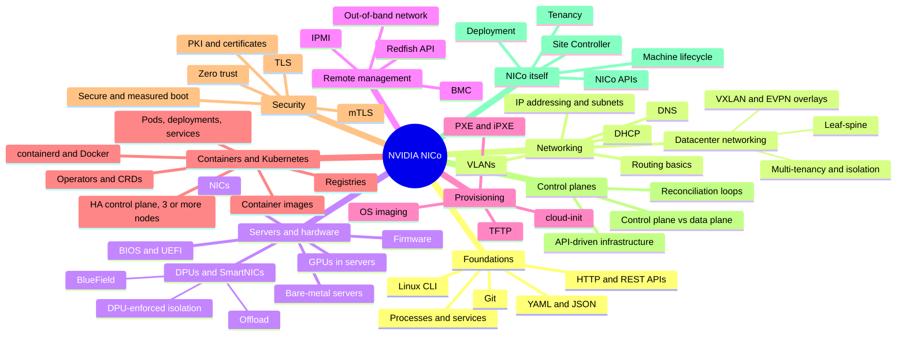

# Guided Learning — Design Document

| | |
|---|---|
| **Status** | Draft v0.1 |
| **Last updated** | 2026-11-20 |
| **Pilot topic** | NVIDIA NICo (NVIDIA Infra Controller) |
| **Related** | [DECISIONS.md](./DECISIONS.md), [RESEARCH-LEARNING-METHODS.md](./RESEARCH-LEARNING-METHODS.md) |

---

## 1. Problem

Technical documentation is written for people who already know the surrounding
field. A learner who opens the docs for a system like NVIDIA NICo hits a wall
of assumed knowledge: Kubernetes, bare-metal provisioning, PXE boot, BMCs and
Redfish, DPUs, network overlays, PKI, zero-trust security, and more. None of
these are explained, because the docs aren't meant to explain them.

The learner then has to:

1. Work out *what* they don't know (hard, because you can't see your own gaps).
2. Find good material for each gap, scattered across the web.
3. Work out an order to learn it in.
4. Find a way to practise, because reading alone doesn't make it stick.

Most people give up at step 1 or 2.

## 2. Vision

**Guided Learning** takes a target topic (e.g. "NVIDIA NICo") and its source
material, and produces a **personalised, ordered curriculum**: chapters that go
from fundamentals to advanced, each ending with something the learner
**builds**. AI does the structuring and breaking down. The learner does the
learning and building.

> "Point it at something hard. It shows you the path from what you know now to
> building with it."

## 3. Goals and non-goals

### Goals

- **G1 — Topic-agnostic.** Works for any technical topic. NICo is the pilot,
  not a special case.
- **G2 — Prerequisite discovery.** Automatically find the concepts a topic
  depends on, recursively, down to what the learner already knows.
- **G3 — Fundamentals → advanced ordering.** Chapters follow the dependency
  order, so no chapter relies on something not yet covered.
- **G4 — Learn by building.** Every chapter ends with a hands-on exercise, and
  the course ends with a capstone project that uses the target topic for real.
- **G5 — Grounded content.** Explanations cite sources (official docs, specs,
  reputable references). AI fills in structure and plain-language explanation,
  not unsourced facts.
- **G6 — Personalisation.** Skip what the learner already knows. Go deeper
  where they struggle.

### Non-goals (for now)

- Not a general-purpose MOOC or video platform.
- Not a replacement for official docs. We link to them and explain them.
- No multi-user or social features (cohorts, forums) in the MVP.
- No hosting real infrastructure for exercises in the MVP. Exercises run
  locally or in simulators (see §8).

## 4. Users

| Persona | Description | Need |
|---|---|---|
| **Self-directed engineer** (primary, the pilot user) | Software engineer who has to learn NICo for work or interest. Knows some programming and Linux, has gaps in infra/networking/hardware. | A clear path, no wasted time on known material, something real to build. |
| **Career switcher** | Little background in the domain. | Much deeper prerequisite tree, more fundamentals. |
| **Team lead / onboarding** (later) | Wants to onboard several people onto a stack. | Shareable, reusable curricula. |

## 5. Core concepts (domain model)

```
Topic ──has──▶ Source[]          (docs, repos, specs the curriculum is built from)
  │
  └─generates─▶ KnowledgeGraph
                  ├── Concept[]      (one teachable idea, e.g. "PXE boot")
                  └── Edge[]         (Concept A is a prerequisite of Concept B)

KnowledgeGraph + LearnerProfile ──▶ Curriculum
                                     └── Chapter[] (ordered, grouped concepts)
                                           ├── Lesson[]     (explanation + sources)
                                           ├── Check[]      (quiz / short answer)
                                           └── Exercise     (hands-on build step)
                                     └── Capstone (final project using the topic)

LearnerProfile: known concepts, self-rating, check results, pace
```

- **Concept**: the atomic unit. Has a name, a short definition, a difficulty
  level (0 = foundational … 5 = topic-specific advanced), estimated effort, and
  source references.
- **Prerequisite edge**: "you must understand A before B". The graph must be a
  DAG (no cycles); the generator must break cycles it creates.
- **Chapter**: a group of related concepts at a similar depth, taught together.
  Produced from a topological order of the graph, clustered by theme.
- **Exercise**: a concrete build task with a clear "done" check (e.g. "Boot a
  VM over PXE from a TFTP server you configured").

## 6. How it works — the pipeline

```
 ┌──────────┐   ┌────────────┐   ┌─────────────┐   ┌────────────┐   ┌──────────┐
 │ 1.Ingest │──▶│ 2.Extract  │──▶│ 3.Expand    │──▶│ 4.Order &  │──▶│ 5.Author │
 │ sources  │   │ concepts   │   │ prereqs     │   │ chapterise │   │ content  │
 └──────────┘   └────────────┘   └─────────────┘   └────────────┘   └──────────┘
                                                                          │
                     ┌──────────────── 6. Learn loop ◀────────────────────┘
                     │  lesson → check → exercise → update profile → adapt
```

### 6.1 Ingest
- Input: topic name + seed URLs (e.g. the NICo docs site and repo).
- Crawl within allowed domains, convert to clean text/markdown, chunk, embed,
  and store with source URL and version.
- Keep a snapshot hash so we know when docs change and content needs refresh.

### 6.2 Extract concepts
- LLM reads the target docs and lists the concepts they **use** and the
  concepts they **assume** (terms used without definition are strong signals of
  prerequisites).
- Output is structured JSON validated against a schema; anything invalid is
  retried or rejected.

### 6.3 Expand prerequisites
- For each assumed concept, ask "what does someone need to know to understand
  this?" — recursively, until reaching a configured floor (e.g. "basic
  programming and command line") or the learner's known set.
- Deduplicate concepts (embedding similarity + LLM merge check), so "K8s" and
  "Kubernetes" become one node.
- Stop conditions: depth limit, floor reached, or concept is marked known.

### 6.4 Order and chapterise
- Plan the **project spine** (D-014): a sequence of build tasks from a toy
  version of the capstone to the real thing. Each concept is attached to the
  first build task that needs it and taught just before it.
- Topological sort of the DAG (deterministic code, not an LLM).
- Cluster adjacent concepts into chapters by theme and depth (LLM proposes,
  code validates that no chapter depends on a later one).
- Prune concepts the learner already knows (from a placement check).

### 6.5 Author content
- Per concept: plain-language explanation, analogy, diagram description, worked
  example, links to the best sources, and 2–5 check questions.
- Per chapter: one hands-on exercise that combines its concepts.
- Retrieval-augmented: the model is given the relevant source chunks and must
  cite them. Unsupported claims are flagged.
- Content is generated lazily (chapter by chapter) to save cost and to adapt to
  the learner's progress.

### 6.6 Learn loop
Grounded in [RESEARCH-LEARNING-METHODS.md](./RESEARCH-LEARNING-METHODS.md).
- **Lesson shape** (D-015): prequestion → worked example with subgoal labels
  → partly completed example → independent problem → self-explanation prompt.
  Guidance fades as mastery rises.
- **Retrieval and spacing** (D-016): checks are built into lessons; finished
  concepts go into a spaced, mixed review queue.
- **Mastery** (D-017): per-concept mastery estimate; a chapter's build task is
  recommended at about 80% mastery, with remediation for weak concepts.
- **Tutor** (D-018): Socratic, hints given in stages, never just hands over the
  answer. Scoped to the current concept and its sources.
- **Map** (D-019): every chapter opens with its place on the map and why the
  end goal needs it.

## 7. Pilot: NVIDIA NICo

NICo (NVIDIA Infra Controller) is an open-source (Apache 2.0) suite of
microservices for site-local, zero-trust bare-metal lifecycle management. It
runs as a control plane (the "Site Controller") on a Kubernetes cluster inside
the datacenter it manages, and makes physical servers behave like cloud
instances through APIs. It sits below Kubernetes/platform layers in the stack.
Its isolation model relies on DPUs.
Source: <https://docs.nvidia.com/infra-controller/documentation/introduction>

That one paragraph already assumes a lot. A **first-guess** prerequisite map
(the pipeline should regenerate and validate this; it is here to set
expectations for what output looks like):

| Level | Chapter (draft) | Example concepts |
|---|---|---|
| 0 | Foundations | Linux CLI, processes & services, YAML/JSON, HTTP & REST APIs, Git |
| 1 | Networking basics | IP addressing & subnets, DHCP, DNS, VLANs, routing basics |
| 1 | Servers & hardware | What a bare-metal server is, BIOS/UEFI, firmware, NICs, GPUs in servers |
| 2 | Remote server management | BMCs, IPMI, Redfish API, out-of-band networks |
| 2 | Network booting & provisioning | PXE, iPXE, TFTP, OS imaging, cloud-init |
| 2 | Containers | Container images, Docker/containerd, registries |
| 3 | Kubernetes | Pods, deployments, services, operators/CRDs, HA control planes (why ≥3 nodes) |
| 3 | Security fundamentals | TLS, PKI & certificates, mTLS, secure/measured boot, zero-trust model |
| 3 | Datacenter networking | Overlays (VXLAN/EVPN), leaf-spine, multi-tenancy & isolation |
| 4 | DPUs & SmartNICs | What a DPU is (e.g. BlueField), offload, DPU-enforced isolation |
| 4 | Microservices & control planes | Control vs data plane, reconciliation loops, API-driven infra |
| 5 | NICo itself | Site Controller architecture, machine lifecycle, tenancy, APIs, deployment |
| 5 | Capstone | Build something with NICo (see below) |

### 7.1 NICo mind map (first guess)

This is what the generated mind map for a topic looks like (see §8a). It is
the same first-guess content as the table above, grouped by theme rather than
by level. GitHub draws it automatically; elsewhere, paste it into
<https://mermaid.live>.



**Capstone idea (to refine):** stand up a small lab — local Kubernetes cluster
plus VMs emulating bare-metal hosts with a virtual BMC (Redfish emulator) —
deploy NICo or its components where feasible, and provision a "machine" end to
end through its API. Where real hardware (DPUs) is required, use documented
simulations or a design-only exercise. Feasibility is an open question (see
DECISIONS.md, D-010).

## 8. Exercises and the "build" part

Exercises are what make this more than a reading list. Tiers:

1. **Local, no special hardware** — CLI tasks, writing configs, small scripts,
   using `kind`/`k3d` for Kubernetes, QEMU/libvirt VMs for "servers",
   Redfish/IPMI emulators (e.g. sushy-tools) for BMCs.
2. **Design exercises** — when hardware isn't available (DPUs, real GPU
   racks): draw/describe the architecture, answer scenario questions, review a
   config.
3. **Real environment** (later) — guidance for learners who have lab access.

Each exercise has: goal, starting state, steps (hidden until requested),
a verification step the learner can run, and common failure hints.
MVP verification is self-reported plus optional output pasting for AI review;
automated checking is a later feature.

## 8a. Topic mind map

Every topic gets a **mind map**: the whole subject on one page, grouped by
theme, with the target topic at the centre. It is the learner's overview and
navigation, and works as an advance organiser (D-019, D-022).

**Mind map vs prerequisite graph.** They show the same concepts in two ways:

| | Mind map | Prerequisite graph (DAG) |
|---|---|---|
| Answers | "What is in this topic, and how is it grouped?" | "What do I need to learn before this?" |
| Shape | Tree: topic → theme → sub-theme → concept | Directed graph of `depends_on` edges |
| Built from | `part_of` edges (D-020) and theme clustering | `depends_on` edges |
| Used for | Overview, navigation, seeing progress | Ordering chapters, placement, gating |

**How it's generated**
1. After concept extraction (§6.2–6.3), the LLM proposes themes and assigns
   each concept to one theme (`part_of` edges), nesting up to 3 levels.
2. Code validates it: every concept appears exactly once, there are no empty
   themes, there is a limit of about 7 children per node (the LLM regroups if
   it's over), and the depth is no more than 4.
3. The tree is stored and rendered. The CLI (M1) outputs it as a Mermaid
   `mindmap` block; the web app (M3) renders it interactively.

**What the learner can do with it**
- **See progress:** each concept is coloured by status (unknown / learning /
  mastered / skipped as known). Each theme shows its completion percentage.
- **Navigate:** click a concept to open its lesson, or a theme to see its
  chapters.
- **See dependencies on demand:** select a concept to show its prerequisites
  and what it unlocks, drawn as arrows over the map. This keeps the map
  readable while the DAG is still one click away.
- **Placement:** mark whole branches as "I know this" during setup; the
  placement quiz (D-011) then confirms it.
- **Edit:** move a concept to another theme, rename a theme. Edits are saved
  with `origin = user_edited` and kept when the map is regenerated.
- **Build their own (later):** at the end of a chapter, the learner can be
  asked to arrange that chapter's concepts into a map themselves, then compare
  it with the generated one. Building concept maps yourself is itself an
  effective learning activity (Nesbit & Adesope, 2006).

## 9. Architecture (MVP)

```
┌──────────────────────── Web app (Next.js + TypeScript) ───────────────────────┐
│  Topic setup · Mind map + prerequisite view · Lesson reader · Checks · Tutor  │
└───────────────────────────────────┬───────────────────────────────────────────┘
                                    │ API routes / server actions
┌───────────────────────────────────▼───────────────────────────────────────────┐
│ Core services (TypeScript)                                                    │
│  ingest/   crawler, cleaner, chunker                                          │
│  graph/    concept extraction, prereq expansion, dedupe, topo-sort, chapters  │
│  author/   lesson, check, exercise generation (RAG + citations)              │
│  learner/  profile, progress, adaptation                                     │
│  llm/      provider wrapper, prompt templates, JSON schema validation, cache │
└───────┬───────────────────────────┬───────────────────────────┬───────────────┘
        │                           │                           │
   ┌────▼─────┐             ┌───────▼────────┐          ┌───────▼────────┐
   │ SQLite → │             │ Vector index   │          │ LLM API        │
   │ Postgres │             │ (sqlite-vec →  │          │ (Claude)       │
   │          │             │  pgvector)     │          │                │
   └──────────┘             └────────────────┘          └────────────────┘
```

Rationale and alternatives are recorded in [DECISIONS.md](./DECISIONS.md).

Key design points:
- **Deterministic where possible.** Graph algorithms, ordering, and validation
  are plain code. The LLM proposes; code checks.
- **Structured outputs everywhere.** Every LLM call returns JSON validated by a
  schema (zod). No free-text parsing.
- **Everything cached and versioned.** Generated graphs and lessons are stored
  with the prompt version, model, and source snapshot hash, so we can
  regenerate selectively and compare.
- **Human-editable.** The learner (or an author) can edit the graph: mark
  known, add/remove a prerequisite, reorder. Edits are preserved across
  regeneration.

## 10. Data model (initial)

```
topics(id, name, description, created_at)
sources(id, topic_id, url, title, fetched_at, content_hash)
chunks(id, source_id, text, embedding, position)
concepts(id, topic_id, name, slug, definition, level, effort_minutes, origin)
concept_sources(concept_id, chunk_id)
edges(from_concept_id, to_concept_id, rationale, origin)   -- from = prerequisite
themes(id, topic_id, parent_theme_id, name, ordinal, origin)   -- mind map tree
concept_themes(concept_id, theme_id)                            -- part_of; one theme per concept
chapters(id, topic_id, ordinal, title, summary)
chapter_concepts(chapter_id, concept_id, ordinal)
lessons(id, concept_id, body_md, prompt_version, model, generated_at)
checks(id, concept_id, kind, prompt, answer_key)
exercises(id, chapter_id, body_md, verification)
learner_profile(concept_id, status, confidence, updated_at)  -- single user in MVP
attempts(id, check_id|exercise_id, response, score, feedback, created_at)
```

`origin` = `generated` | `user_edited`, so regeneration respects human edits.

## 11. Quality and trust

AI-generated curricula can be wrong in subtle ways. Mitigations:

- **Citations required** for factual claims in lessons; uncited claims are
  visually marked.
- **Graph sanity checks**: no cycles, no orphan concepts, every target-topic
  concept reachable from the floor, depth within limits.
- **Self-review pass**: a second LLM call critiques each lesson against its
  sources and flags errors before showing it.
- **Feedback buttons** on every lesson ("wrong", "confusing", "too easy") feed
  regeneration.
- **Eval set**: for the pilot, a hand-written reference prerequisite list for
  NICo to measure the extractor's recall and precision.

## 12. Milestones

| Milestone | Scope | Exit criteria |
|---|---|---|
| **M0 — Docs** | This design doc + decisions log | Agreed direction |
| **M1 — Graph CLI** | Ingest NICo docs, extract + expand concepts, output a DAG, a mind map (Mermaid) and a chapter list as JSON/Markdown | Graph looks sensible to the pilot user; passes sanity checks |
| **M2 — Content CLI** | Generate lessons, checks, and an exercise for the first 2–3 chapters | Pilot user can actually learn from chapter 1–2 |
| **M3 — Web MVP** | Curriculum map, lesson reader, checks, progress, tutor | Pilot user uses it end-to-end for a week |
| **M4 — Personalisation** | Placement quiz, skip-known, remediation | Measurably less time on known material |
| **M5 — Second topic** | Run the pipeline on a different topic with no code changes | Proves topic-agnosticism (G1) |

Starting CLI-first (M1–M2) means we validate the hard part — whether the AI
breakdown is actually good — before building UI.

## 13. Risks

| Risk | Impact | Mitigation |
|---|---|---|
| Hallucinated or wrong explanations | Learner learns wrong things | RAG + citations, self-review, feedback |
| Prerequisite explosion (graph grows huge) | Overwhelming, costly | Depth limit, floor, placement quiz, merge duplicates |
| Bad ordering / chapter grouping | Confusing path | Deterministic topo-sort, validation, user editing |
| Exercises infeasible without hardware (DPUs, racks) | Can't "build" | Emulators, tiered exercises, design exercises |
| LLM cost | Expensive per topic | Lazy generation, caching, cheaper models for simple steps |
| Docs change | Stale content | Snapshot hashes, selective regeneration |
| Licensing of crawled content | Legal | Store for private use, link out, quote minimally |

## 14. Open questions

Tracked in [DECISIONS.md](./DECISIONS.md) as `Proposed` / `Open` entries.
Biggest ones:

1. How much can a learner realistically run of NICo locally? (D-010)
2. How is the learner's starting knowledge captured — self-report, quiz, or
   both? (D-011)
3. Single-user local app vs hosted multi-user from day one? (D-004)
